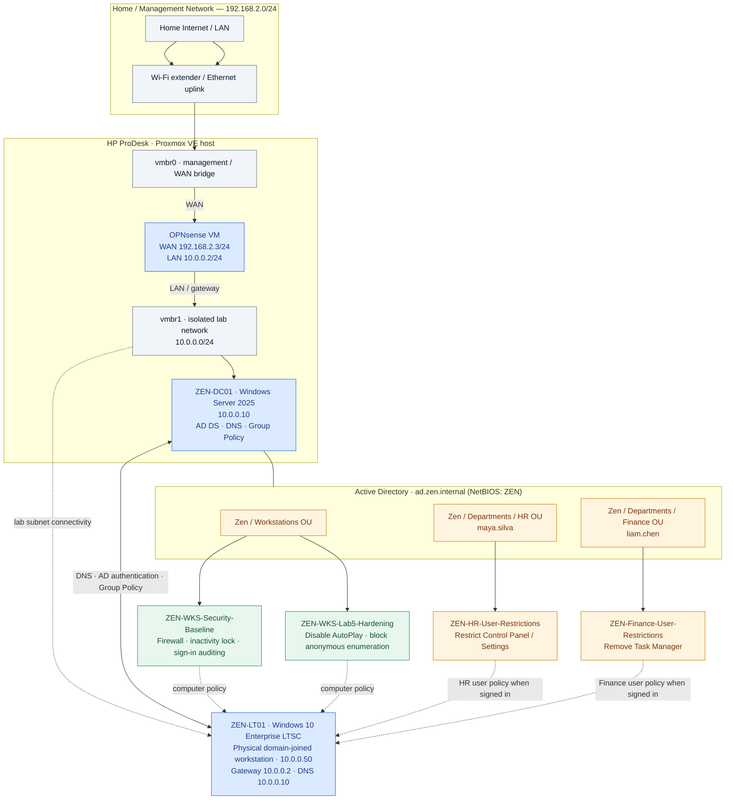

# Windows Enterprise Endpoint Security & Group Policy Management

**Active Directory Domain Services · Windows Server 2025 · Windows 10 Enterprise LTSC · Group Policy · Endpoint Hardening · Troubleshooting**

## Project overview

This project builds and secures a domain-joined Windows workstation in a small enterprise-style Active Directory environment. A Windows Server 2025 domain controller centralizes authentication, DNS and Group Policy management. Security settings are applied to the workstation through computer-scoped GPOs, while separate user-scoped GPOs enforce department-specific restrictions for HR and Finance.

The implementation combines domain joining, OU-based policy targeting, workstation security baselines, additional endpoint hardening, and verification with native Windows administration tools. The environment runs on a segmented Proxmox home lab with OPNsense providing the lab's default gateway.

### Objectives

- Join a Windows 10 Enterprise LTSC endpoint to the `ad.zen.internal` Active Directory domain.
- Organize workstation and user accounts under appropriate OUs to target Group Policy correctly.
- Apply a domain workstation security baseline covering firewall, interactive-session security and sign-in auditing.
- Apply separate user restrictions to HR and Finance without affecting other departments.
- Add removable-media AutoPlay and anonymous network-enumeration hardening in a dedicated GPO.
- Validate effective policy settings and investigate policy processing with `gpupdate`, `gpresult`, Local Security Policy, PowerShell and Event Viewer.

## Architecture

The diagram shows the **logical** connectivity of the physical Windows endpoint and the virtual infrastructure. The endpoint is a separate physical machine; its connection to the lab subnet is shown logically rather than as a claimed Proxmox VM attachment.



**Diagram files:** [Vector architecture diagram](diagrams/windows-endpoint-security-architecture.svg) · [Editable Graphviz source](diagrams/windows-endpoint-security-architecture.dot)

### Environment inventory

| Component | System / purpose | Address or configuration |
| --- | --- | --- |
| Hypervisor | HP ProDesk running Proxmox VE | `vmbr0` home/uplink; `vmbr1` lab bridge |
| Virtual firewall | OPNsense | WAN `192.168.2.3/24`; LAN `10.0.0.2/24` |
| Domain controller | `ZEN-DC01` · Windows Server 2025 | `10.0.0.10` · AD DS, DNS, GPMC |
| Domain | Zen Active Directory forest/domain | `ad.zen.internal` · NetBIOS `ZEN` |
| Lab network | Windows server / endpoint subnet | `10.0.0.0/24` |
| Windows endpoint | `ZEN-LT01` · Windows 10 Enterprise LTSC (build 17763) | `10.0.0.50/24` · gateway `10.0.0.2` · DNS `10.0.0.10` |

> The domain controller provides the domain's DNS service. The client points at `10.0.0.10` for DNS so Active Directory service discovery and domain operations work correctly; OPNsense is the default IP gateway, not the AD DNS replacement.

## Active Directory organization and policy scope

The domain uses separate OUs for computer administration and departmental users. This enables **computer configuration** policies to follow the workstation object, while **user configuration** policies follow the relevant departmental user objects.

```text
ad.zen.internal
└── Zen
    ├── Workstations
    │   └── ZEN-LT01 (computer account)
    └── Departments
        ├── HR
        │   └── maya.silva (test account)
        └── Finance
            └── liam.chen (test account)
```

| Group Policy Object | Linked OU | Policy scope | Purpose |
| --- | --- | --- | --- |
| `ZEN-WKS-Security-Baseline` | `Zen / Workstations` | Computer | Enterprise workstation firewall, session and sign-in baseline |
| `ZEN-WKS-Lab5-Hardening` | `Zen / Workstations` | Computer | Additional removable-media and anonymous-access restrictions |
| `ZEN-HR-User-Restrictions` | `Zen / Departments / HR` | User | Limit HR users' access to Windows Control Panel / Settings |
| `ZEN-Finance-User-Restrictions` | `Zen / Departments / Finance` | User | Prevent Finance users from opening Task Manager |

**How targeting works:** The workstation receives computer policies from the Workstations OU. When `ZEN\maya.silva` or `ZEN\liam.chen` signs in, their respective user policies are evaluated from the user's OU. This is why the same workstation can have a consistent security baseline yet a different user experience for each department.

## Implementation

### 1. Domain join and workstation placement

1. Configured the Windows client's address on the `10.0.0.0/24` lab network and set DNS to the domain controller (`10.0.0.10`).
2. Verified connectivity and domain name resolution.
3. Joined the Windows 10 Enterprise LTSC machine to `ad.zen.internal` using authorized domain credentials.
4. Restarted the endpoint to complete the join.
5. Verified the computer account in Active Directory Users and Computers and organized it under the `Zen / Workstations` OU.
6. Tested domain authentication using the configured HR and Finance accounts.

Useful connectivity checks:

```powershell
ipconfig /all
nslookup ad.zen.internal 10.0.0.10
ping 10.0.0.10
whoami
```

### 2. Workstation security baseline

Created and linked `ZEN-WKS-Security-Baseline` to the **Workstations** OU. Its computer-level settings enforce a consistent security posture regardless of which departmental user is logged in.

| Security control | Applied configuration | Why it matters |
| --- | --- | --- |
| Windows Defender Firewall (Domain profile) | Enabled | Provides host-based filtering on the domain network |
| Domain firewall inbound policy | Block | Reduces unwanted inbound exposure unless an allowed rule applies |
| Domain firewall outbound policy | Allow | Permits normal outbound traffic unless explicitly restricted |
| Machine inactivity limit | `600` seconds (10 minutes) | Locks an unattended interactive session |
| Last signed-in user display | Disabled display of last signed-in user information | Reduces user information exposure at the sign-in screen |
| Audit logon events | Success and Failure | Records authentication-related events for investigation |
| Audit-policy subcategory enforcement | Enabled | Ensures advanced audit subcategory settings take precedence where configured |

Configuration areas used in Group Policy Management Editor:

- **Windows Defender Firewall with Advanced Security** for the Domain profile.
- **Computer Configuration → Policies → Windows Settings → Security Settings → Local Policies → Security Options** for interactive-logon options.
- **Computer Configuration → Policies → Windows Settings → Security Settings → Advanced Audit Policy Configuration** for logon auditing.

### 3. Department-specific user restrictions

Created separate user GPOs to demonstrate role-based Windows administration without changing the workstation's shared security baseline.

**HR — `ZEN-HR-User-Restrictions`**

- Linked the GPO to the HR OU.
- Enabled **Prohibit access to Control Panel and PC settings**.
- Tested with `ZEN\maya.silva`.

**Finance — `ZEN-Finance-User-Restrictions`**

- Linked the GPO to the Finance OU.
- Enabled **Remove Task Manager** under **User Configuration → Policies → Administrative Templates → System → Ctrl+Alt+Del Options**.
- Tested with `ZEN\liam.chen`.

These controls illustrate the difference between **OU targeting of users** and **OU targeting of computers**, and how different users can receive different settings on the same managed device.

### 4. Additional endpoint hardening

Created the dedicated `ZEN-WKS-Lab5-Hardening` GPO and linked it to `Zen / Workstations`. Separating these settings from the main baseline simplifies change review and rollback.

| Policy | Setting | Group Policy location |
| --- | --- | --- |
| **Turn off AutoPlay** | **Enabled**, applied to **All drives** | Computer Configuration → Policies → Administrative Templates → Windows Components → AutoPlay Policies |
| **Network access: Do not allow anonymous enumeration of SAM accounts and shares** | **Enabled** | Computer Configuration → Policies → Windows Settings → Security Settings → Local Policies → Security Options |

**Why these settings were selected:** Disabling AutoPlay prevents Windows from automatically acting on inserted-media content. Restricting anonymous SAM/share enumeration limits unauthenticated network users' ability to discover account and share names. The second policy may affect legacy systems that depend on anonymous enumeration, so compatibility should be considered before enterprise-wide deployment.

### 5. Apply and verify Group Policy

On the Windows 10 workstation, refreshed policy and inspected the resultant computer-policy list:

```cmd
gpupdate /force
gpresult /scope computer /r
```

Confirmed that the following computer GPOs were present in the applied-policy results:

```text
ZEN-WKS-Security-Baseline
ZEN-WKS-Lab5-Hardening
```

Checked **Local Security Policy** (`secpol.msc`) under **Local Policies → Security Options** for the effective anonymous-enumeration setting. Also verified the settings through a detailed Group Policy HTML report:

```cmd
gpresult /scope computer /h "C:\Users\Public\Documents\Lab5-GPO-Report.html" /f
```

The HTML report can be opened locally in a browser to review applied GPOs and detailed policy settings. Any version committed publicly should be sanitized first to avoid exposing account names, SIDs or other environment-specific details.

Additional workstation verification commands:

```powershell
# Effective Domain firewall profile
Get-NetFirewallProfile -Name Domain -PolicyStore ActiveStore |
    Select-Object Name, Enabled, DefaultInboundAction, DefaultOutboundAction

# Effective interactive-session inactivity timeout (seconds)
Get-ItemPropertyValue `
    -Path 'HKLM:\SOFTWARE\Microsoft\Windows\CurrentVersion\Policies\System' `
    -Name InactivityTimeoutSecs

# Effective logon audit configuration
auditpol /get /subcategory:"Logon"
```

For departmental user settings, `gpresult /r` run **within the relevant signed-in user's session** can show user-scoped applied policies. Computer-scoped `gpresult` output alone does not verify HR or Finance restrictions.

### 6. Policy processing and event-log troubleshooting

Used Event Viewer on the workstation to inspect Group Policy processing:

```text
Event Viewer
└── Applications and Services Logs
    └── Microsoft
        └── Windows
            └── GroupPolicy
                └── Operational
```

Correlated the log timestamps with the `gpupdate /force` run and reviewed recent Information, Warning and Error events. This helps identify whether failures come from policy discovery, connectivity, access or policy processing rather than assuming that a GPO was enforced just because it exists on the domain controller.

Useful PowerShell alternatives for event inspection:

```powershell
# Recent Group Policy operational events
Get-WinEvent -LogName 'Microsoft-Windows-GroupPolicy/Operational' `
    -MaxEvents 20 |
    Select-Object TimeCreated, Id, LevelDisplayName, Message

# Recent successful/failed logon events (run elevated where permitted)
Get-WinEvent -FilterHashtable @{LogName='Security'; Id=4624,4625} `
    -MaxEvents 20 |
    Select-Object TimeCreated, Id, Message
```

The event IDs represent logon successes (`4624`) and failures (`4625`); their presence depends on the active audit configuration and recorded activity.

## Validation summary

| Verification | Method | Outcome |
| --- | --- | --- |
| Domain integration | Domain join, DNS and AD computer object | Windows endpoint joined to `ad.zen.internal` |
| Department policy targeting | Signed-in HR and Finance test users | Separate user restrictions evaluated for each department |
| Workstation baseline | GPO checks, firewall and audit inspection | Baseline computer settings configured and evaluated |
| Endpoint hardening GPO | `gpupdate /force`, `gpresult /scope computer /r` | Hardening GPO appeared in applied computer policies |
| Anonymous enumeration control | `secpol.msc` | Effective setting checked on the endpoint |
| Policy processing | Event Viewer GroupPolicy/Operational | Processing events reviewed for troubleshooting |
| Policy export | `gpresult /h` | Detailed HTML report workflow documented |

## Skills demonstrated

- Windows Server 2025 Active Directory Domain Services and DNS administration
- Windows endpoint domain joining and computer object management
- OU design and user-vs-computer Group Policy targeting
- Security baseline design: Windows Firewall, interactive sessions and logon auditing
- Department-based administrative restrictions for HR and Finance
- Removable media and anonymous network-enumeration hardening
- Troubleshooting with `gpupdate`, `gpresult`, Local Security Policy, PowerShell and Event Viewer
- Clear separation of baseline and incremental security GPOs for maintainability

## Operational considerations

- Group Policy scope matters: a user GPO linked to HR does not automatically apply to every user of an HR workstation.
- Domain policy processing depends on correctly resolving and reaching Active Directory services. The client uses the domain controller for DNS.
- Security policies should be tested against real application requirements before broad production rollout.
- This is a controlled learning environment. IP addresses, account names and policy names are lab-specific examples, not production configuration guidance.
- Reports published outside the lab should be reviewed and sanitized before public release.

## Tools and technologies

`Windows Server 2025` · `Active Directory DS` · `DNS` · `Group Policy Management` · `Windows 10 Enterprise LTSC` · `PowerShell` · `Event Viewer` · `Windows Defender Firewall` · `Proxmox VE` · `OPNsense`
